# COMP 3613 Assignment 1

Draft this file with the Guide. **Update it after every phase milestone** before you pause. The use-case diagram is a UML PNG at `docs/diagrams/use-case.png`, linked from this file as `diagrams/use-case.png` (path relative to `docs/report.md`). The model diagram is Mermaid. **Embed wireframe images** as `wireframes/<file>` (files live in `docs/wireframes/`).

Do not put your student ID in this file if you will commit it. The PDF cover adds your name and ID at export time.

## Assigned project
Student Accommodation — a marketplace for students near UWI St. Augustine to find secure rental listings, book alone or with roommates, and review stays.

## Three workflows

### 1. List and verify a property (Landlord)

Landlord creates and submits a property listing for verification. An Admin approves it, making it public with a Verified badge, or rejects it with a reason so the Landlord can edit and resubmit. Listing details include title, address, monthly price, room type, capacity, amenities, and photos.

### 2. Book a stay with roommates (Student)

The Student browses verified listings by price, distance from campus, and room type, then requests a stay with move-in and move-out dates. They may invite Roommates by username or email up to the listing's capacity; each invited Roommate accepts or declines. Once responses are in, the Landlord accepts or declines with a reason. Everyone on the booking sees its status. A confirmed booking lists accepted tenants and blocks those dates; a declined booking shows the reason to the Student and Roommates.

### 3. Review a completed stay (Tenant)

After a confirmed booking's end date, a Student or Roommate who stayed can submit one review for that booking, with a 1–5 star rating and comment. The review appears on the listing and updates its average rating. Only tenants on a completed booking may review, and each tenant may review a booking once.

### Assumptions

- Campus is UWI St. Augustine.
- Payments are out of scope.
- Login and roles are minimal supporting behaviour.
- A Roommate is a student invited onto someone else's booking.

## Use case diagram

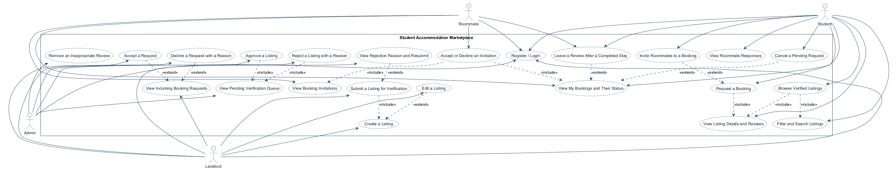

Draft notes:
- Shared access is modeled as a single `Register / Login` use case used by all actor types.
- The Student browsing flow includes filtering and viewing listing details before requesting a stay, while roommate invites are modeled as an optional extension of the booking request.
- Landlord verification and rejection/resubmission are separated from the listing lifecycle, and admin moderation is kept as a distinct queue-and-review flow.
- No extra product or workflow was invented beyond the Phase 1 scope.

## Model diagram

Phase 3 model supplied by the student and recorded for Phase 5 implementation.

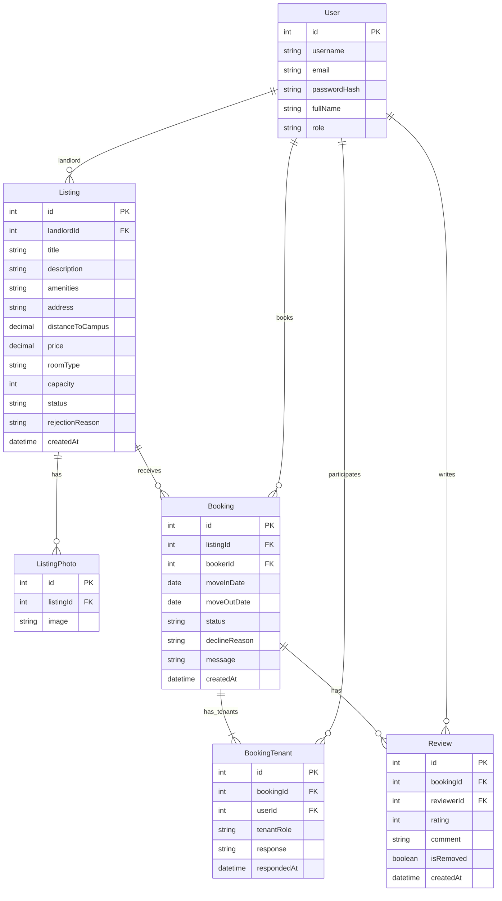

Model rules:
- `User.role` is `student`, `landlord`, or `admin`; listing and booking lifecycle values follow the statuses in the workflows.
- Every booking has exactly one booker `BookingTenant` whose `userId` matches `Booking.bookerId`; roommate rows are additional tenants.
- A reviewer can review a booking only once. A listing's reviews are reached through its bookings; `Review` has no `listingId`.
- The implementation enforces one review per `(bookingId, reviewerId)` with a database uniqueness constraint; removed reviews are hidden from listing averages but still count as already submitted.
- Photo and amenities storage formats are not specified by the model; preserve them without adding domain fields.

## Wireframes

### Register / Login
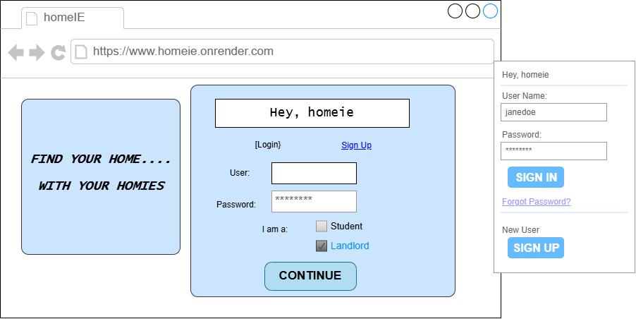

### Landlord: My Listings
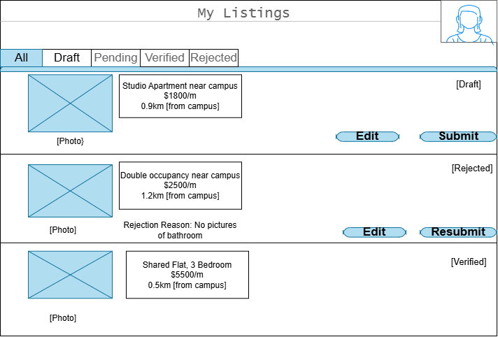

### Landlord: Create a Listing
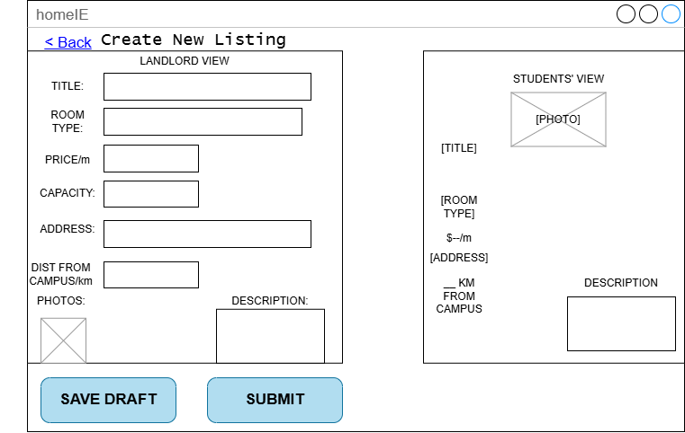

### Admin: Verification Queue
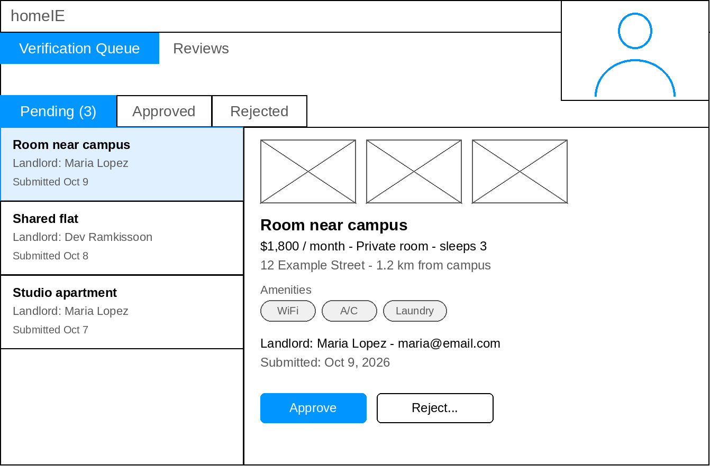

### Admin: Reject a Listing
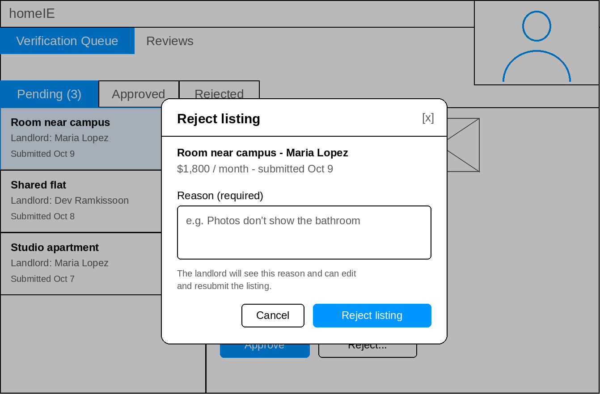

### Student: Browse Listings
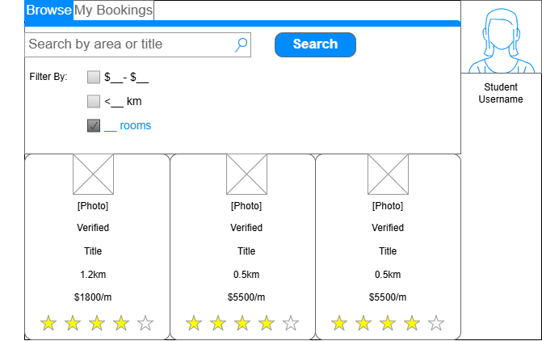

### Student: Listing Details and Booking Request
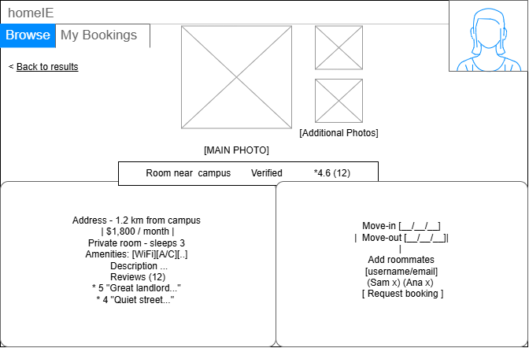

### Student: Bookings and Invitations
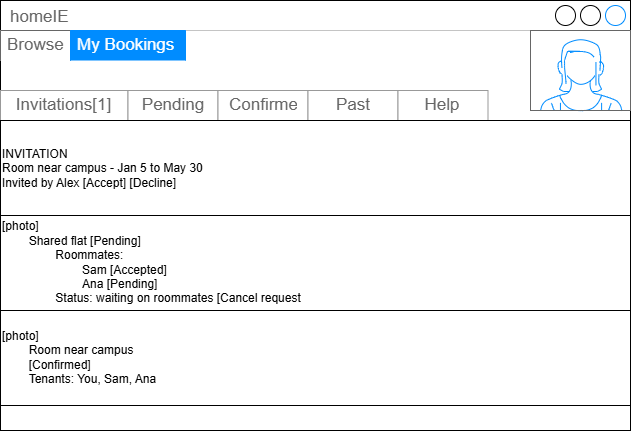

### Landlord: Incoming Booking Requests
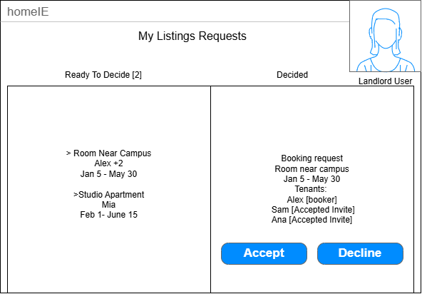

### Landlord: Decline a Booking
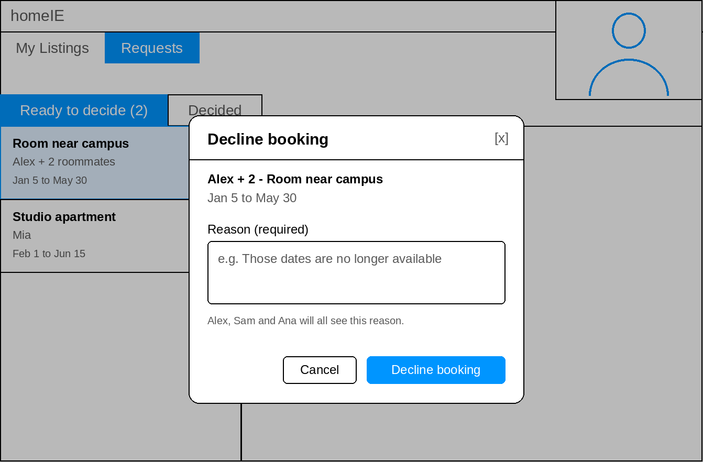

### Tenant: Leave a Review
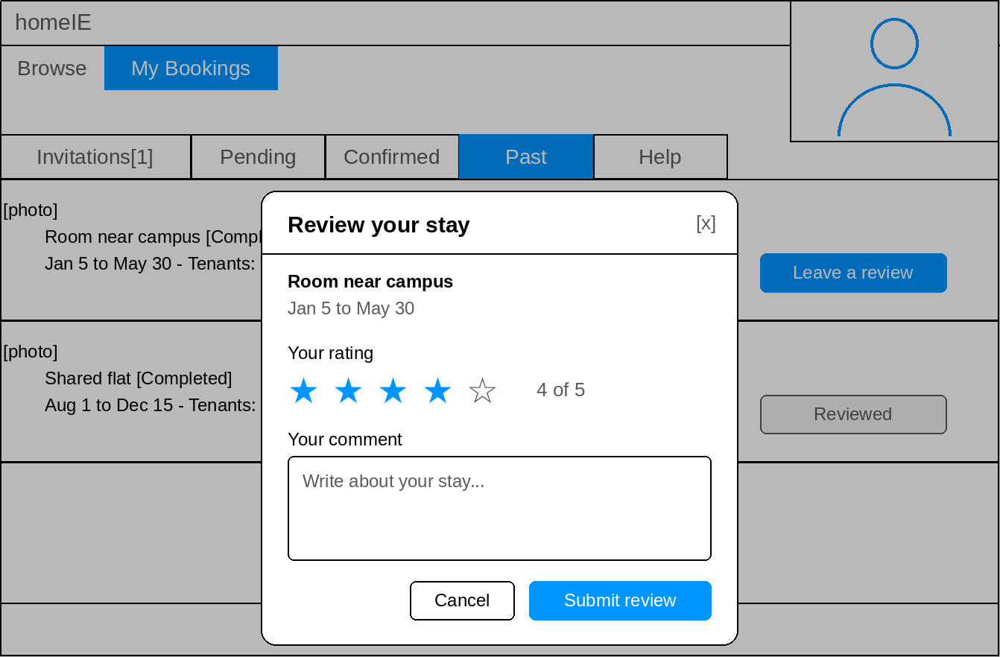

### Student: Listing Reviews
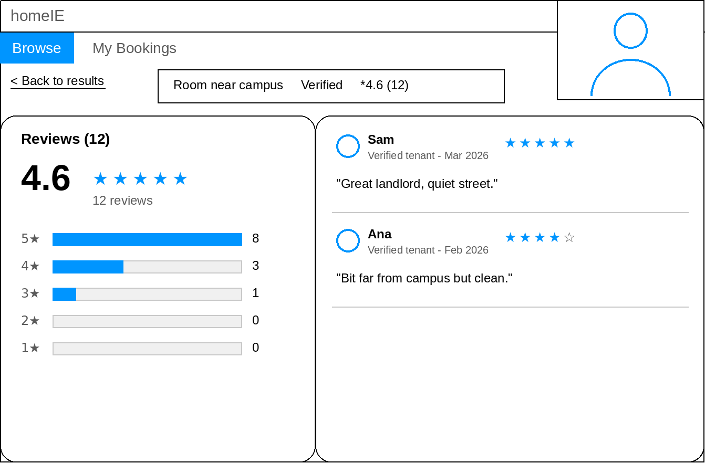

### Admin: Remove a Review
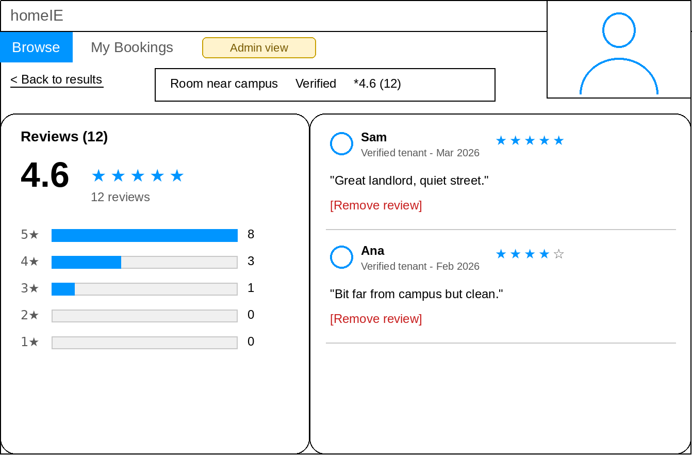

### Admin: Confirm Review Removal
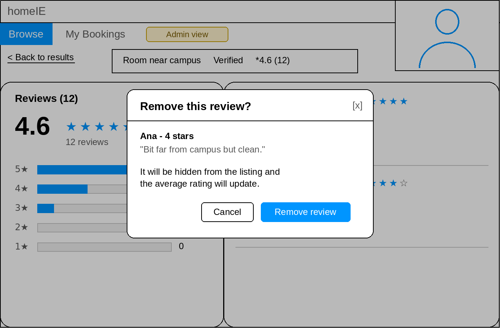

<!-- student-build:wireframe-coverage
use_case: Register / Login
image: docs/wireframes/w1-1-login.png
covered: yes
-->
<!-- student-build:wireframe-coverage
use_case: Browse Verified Listings
image: docs/wireframes/w2-1-browse.png
covered: yes
-->
<!-- student-build:wireframe-coverage
use_case: Filter and Search Listings
image: docs/wireframes/w2-1-browse.png
covered: yes
-->
<!-- student-build:wireframe-coverage
use_case: View Listing Details and Reviews
image: docs/wireframes/w2-2-listing-details.png
covered: yes
-->
<!-- student-build:wireframe-coverage
use_case: Request a Booking
image: docs/wireframes/w2-2-listing-details.png
covered: yes
-->
<!-- student-build:wireframe-coverage
use_case: Invite Roommates to a Booking
image: docs/wireframes/w2-2-listing-details.png
covered: yes
-->
<!-- student-build:wireframe-coverage
use_case: View Roommate Responses
image: docs/wireframes/w2-3-studentbookings.png
covered: yes
-->
<!-- student-build:wireframe-coverage
use_case: View My Bookings and Their Status
image: docs/wireframes/w2-3-studentbookings.png
covered: yes
-->
<!-- student-build:wireframe-coverage
use_case: Cancel a Pending Request
image: docs/wireframes/w2-3-studentbookings.png
covered: yes
-->
<!-- student-build:wireframe-coverage
use_case: Leave a Review After a Completed Stay
image: docs/wireframes/w3-1-leave-review.png
covered: yes
-->
<!-- student-build:wireframe-coverage
use_case: View Booking Invitations
image: docs/wireframes/w2-3-studentbookings.png
covered: yes
-->
<!-- student-build:wireframe-coverage
use_case: Accept or Decline an Invitation
image: docs/wireframes/w2-3-studentbookings.png
covered: yes
-->
<!-- student-build:wireframe-coverage
use_case: Create a Listing
image: docs/wireframes/w1-3-createListing.png
covered: yes
-->
<!-- student-build:wireframe-coverage
use_case: Edit a Listing
image: docs/wireframes/w1-2-landlord-view-listings.png
covered: yes
-->
<!-- student-build:wireframe-coverage
use_case: Submit a Listing for Verification
image: docs/wireframes/w1-3-createListing.png
covered: yes
-->
<!-- student-build:wireframe-coverage
use_case: View Rejection Reason and Resubmit
image: docs/wireframes/w1-2-landlord-view-listings.png
covered: yes
-->
<!-- student-build:wireframe-coverage
use_case: View Incoming Booking Requests
image: docs/wireframes/w2-4-landlordBookingReq.png
covered: yes
-->
<!-- student-build:wireframe-coverage
use_case: Accept a Request
image: docs/wireframes/w2-4-landlordBookingReq.png
covered: yes
-->
<!-- student-build:wireframe-coverage
use_case: Decline a Request with a Reason
image: docs/wireframes/w2-5-landlord-decline-reason.png
covered: yes
-->
<!-- student-build:wireframe-coverage
use_case: View Pending Verification Queue
image: docs/wireframes/w1-4-admin-verification-queue.png
covered: yes
-->
<!-- student-build:wireframe-coverage
use_case: Approve a Listing
image: docs/wireframes/w1-4-admin-verification-queue.png
covered: yes
-->
<!-- student-build:wireframe-coverage
use_case: Reject a Listing with a Reason
image: docs/wireframes/w1-5-admin-reject-reason.png
covered: yes
-->
<!-- student-build:wireframe-coverage
use_case: Remove an Inappropriate Review
image: docs/wireframes/w3-4-admin-remove-confirm.png
covered: yes
-->

## Theming

- **Brand:** homeIE — “Your Place, Your People”; friendly, playful, welcoming, and trustworthy for students and landlords.
- **Logo:** The replacement hand-drawn logo is at `docs/wireframes/homeie-logo.png` and is served from `app/static/img/homeie-logo.png`; both files were hash-checked and match.
- **Palette:** near-black `#1A1A1A` text, warm off-white `#FFFCFF` background, lilac `#C8B6F6`, light blue `#B9DDF7`, lavender `#EAE2FF`, pale blue `#E5F3FF`, and verified mint `#2BB39A`. Draft, pending, verified, rejected, confirmed, and declined status tokens use distinct soft colors with dark readable text.
- **Typography and style:** rounded Nunito headings with Inter body text; rounded cards and controls, subtle borders, generous whitespace, and responsive layouts.
- **Applied:** landing, login, registration, and the authenticated shell use the homeIE tokens and visual style. The logo displays directly on the light background and links back to the landing page on login and registration. Landing-page sign-in and get-started actions are only in the header.

## Implementation notes

One named workflow at a time. Include verify notes and polish / model revisions (Phase 5). Do not treat the first build as final.

### Theming milestone

Implemented the homeIE landing, login, registration, shared CSS tokens, status colors, and authenticated-shell styling. The student verified the updated desktop landing and login pages, and confirmed the new logo is clear and registration matches.

### Workflow 1: List and verify a property

Implemented the landlord create/edit/listing flows and admin verification queue using the Phase 3 Listing, ListingPhoto, and User entities. Drafts can be saved; submitted listings enter pending review; admin approval marks them verified; rejection requires a reason; landlords can edit rejected listings and resubmit. Students' Browse screen queries verified listings only. Login routes students to Browse, landlords to My Listings, and admins to the Verification Queue. Registration offers Student or Landlord; admin is only available from seeded accounts.

Photo entry accepts one `/static/` path or `http(s)` image URL per line. Demo images are bundled SVGs under `app/static/img/listings/`, so they remain available after Render redeploys. No uploaded image files are stored on the app filesystem.

The starter has no schema-migration tool. Run `python manage.py init` before first use to recreate tables and seed demo data; this drops the existing local database by default, so back up any local data first. `python manage.py init --no-drop` does not migrate a previous schema.

<!-- student-build:code-check
workflow: List and verify a property
form: choice
layer: other
architecture_ok: yes
implement_confidence: 0.90
passed: yes
note: Chose ListingPhoto.image URLs to avoid ephemeral uploaded files on Render; seeded images will be bundled static assets.
-->
<!-- student-build:code-check
workflow: List and verify a property
form: mcq
layer: service
architecture_ok: yes
implement_confidence: 0.90
passed: yes
note: Correctly placed listing approval/rejection decisions and state transitions in the service.
-->

<!-- student-build:code-check
workflow: List and verify a property
form: snippet
layer: model
architecture_ok: yes
implement_confidence: 0.90
passed: yes
note: Student added the listing status field; implementation retained it and completed the ERD description and ListingPhoto table.
-->
<!-- student-build:code-check
workflow: List and verify a property
form: snippet
layer: router
architecture_ok: yes
implement_confidence: 0.90
passed: yes
note: Student's route snippet constructed ListingRepository and ListingService and delegated creation to the service; no persistence logic in the route.
-->

### Workflow 1 verification and polish

The database was recreated with `python manage.py init`; seeding created the demo accounts and five listings (verified, rejected with reason, pending, and draft). The student later verified the landlord create-and-submit flow, admin approval and reasoned rejection, landlord edit/resubmission, and verified-listing visibility for students.

Polish requested: admin verification continues to use the shared homeIE sidebar and welcome bar, with the admin label normalized to `Welcome, admin`; listing cards use “sleeps N” and grouped monthly prices; room type is limited to Private room, Shared room, Studio, and Shared flat (the demo seed values already match); Browse cards use wider columns and reserve space for the Verified badge; success flashes are soft green, while rejection and error flashes are soft red. The student reports local end-to-end verification of listing submission, admin approval/rejection, landlord resubmission, and student visibility.

### Workflow 2: Student booking request (with roommates)

Added nullable `Booking.message` to the Phase 3 ERD by student choice to support the optional landlord message in the Workflow 2 request form. Roommate usernames will be entered one per line. The student selected Service ownership for the pending-roommates versus pending-landlord transition.

<!-- student-build:code-check
workflow: Student booking request (with roommates)
form: choice
layer: other
architecture_ok: yes
implement_confidence: 0.80
passed: yes
note: Chose one roommate username per line; the request form will parse that format.
-->
<!-- student-build:code-check
workflow: Student booking request (with roommates)
form: mcq
layer: service
architecture_ok: yes
implement_confidence: 0.80
passed: yes
note: Correctly chose the service to coordinate the status transition based on roommate invitations.
-->

<!-- student-build:code-check
workflow: Student booking request (with roommates)
form: snippet
layer: model
architecture_ok: yes
implement_confidence: 0.72
passed: partial
note: Initial model had the booker tenant role defaulted to roommate and no Booking.message; it took several edits to correct both fields.
-->
<!-- student-build:code-check
workflow: Student booking request (with roommates)
form: snippet
layer: model
architecture_ok: yes
implement_confidence: 0.45
passed: yes
note: On the second pass, removed the malformed line; Booking.message is nullable and BookingTenant's default role is booker.
-->

The model snippet now matches the approved message-field revision and booker role. Implement confidence is low, so the student must also complete repository and service snippets before the required thin route snippet.

<!-- student-build:code-check
workflow: Student booking request (with roommates)
form: snippet
layer: repository
architecture_ok: yes
implement_confidence: 0.45
passed: yes
note: Student implemented creation of a Booking and its BookingTenant rows in BookingRepository; guard and rollback handling were added around the snippet.
-->
<!-- student-build:code-check
workflow: Student booking request (with roommates)
form: snippet
layer: service
architecture_ok: yes
implement_confidence: 0.35
passed: partial
note: Date, student-role, listing visibility, and capacity checks are present; needs the repository API corrected, duplicate invite rejection, duplicate active-request prevention, and the ERD's booker role value.
-->
<!-- student-build:code-check
workflow: Student booking request (with roommates)
form: snippet
layer: service
architecture_ok: yes
implement_confidence: 0.35
passed: partial
note: Student corrected the repository lookup; remaining validation gaps were completed after the student's second-pass attempt.
-->

After the service attempt, completed the missing duplicate-invite and active-request checks, ensured the ERD `booker` tenant role is used, and guarded persisted IDs before creation.

<!-- student-build:code-check
workflow: Student booking request (with roommates)
form: snippet
layer: router
architecture_ok: yes
implement_confidence: 0.35
passed: yes
note: Student's route binds the request and delegates creation to BookingService; no persistence logic is in the handler.
-->

The student completed the required thin route snippet; it checks the student role, constructs the service with its repositories, delegates validation and persistence, and redirects with status feedback.

Workflow 2 implementation adds verified-only listing details and the booking form; student booking tabs and roommate invitations; landlord tabs and decision actions; and server-side role, ownership, and current-status checks. Booking state transitions are coordinated by `BookingService`, while query and persistence operations stay in repositories. Roommate acceptance advances only when every invite is accepted; any roommate decline cancels the booking, with the declined roommate shown to the lead. Landlord declines require a reason.

The `sara` student account and seeded bookings cover pending roommates, pending landlord, confirmed, declined, and cancelled states, plus a past confirmed booking. Seed listings use repository-bundled static images. Six focused tests cover multi-roommate transitions, invitation ownership and state, landlord visibility and ownership, required decline reasons, student cancellation permissions, and verified-only listing access.

<!-- student-build:verification
workflow: Student booking request (with roommates)
status: student reports end-to-end local verification complete on 2026-10-12; filtered verified listings, dated booking request, roommate invitation and acceptance, landlord acceptance and reasoned decline, and status visible to participants
-->

### Workflow 3: Post-stay review

Started from the Phase 3 Review entity and W3 wireframes. Student chose service-level review eligibility decisions. Review comments will use a required 20–1000 character range; this is a workflow detail, not a new model field.

<!-- student-build:code-check
workflow: Post-stay review
form: mcq
layer: service
architecture_ok: yes
implement_confidence: 0.80
passed: yes
note: Correctly chose the service to coordinate eligibility and reject unauthorized review attempts.
-->

<!-- student-build:code-check
workflow: Post-stay review
form: snippet
layer: model
architecture_ok: yes
implement_confidence: 0.55
passed: partial
note: Student added the ERD fields and uniqueness rule; required comment nullability needed a final correction.
-->
<!-- student-build:code-check
workflow: Post-stay review
form: snippet
layer: repository
architecture_ok: yes
implement_confidence: 0.55
passed: yes
note: Student queried by both booking and reviewer IDs and returned the first match.
-->
<!-- student-build:code-check
workflow: Post-stay review
form: snippet
layer: service
architecture_ok: yes
implement_confidence: 0.55
passed: yes
note: Student implemented role, booking, tenant response, move-out, duplicate, rating, and comment validation in the service.
-->
<!-- student-build:code-check
workflow: Post-stay review
form: snippet
layer: router
architecture_ok: yes
implement_confidence: 0.55
passed: yes
note: Student's thin route delegates to ReviewService and redirects with feedback; no persistence logic is in the handler.
-->

Workflow 3 now supports eligible post-stay reviews with server-side service validation and a database uniqueness constraint. The student form appears for past confirmed stays; submitted reviews show as Reviewed. Listing details show newest-first reviews, reviewer first names, dates, average, and count; Browse and My Listings show average/count. Removed reviews are excluded from public summaries.

Workflow 2 polish adds count badges to all My Bookings tabs and Accept/Decline controls on pending roommate booking cards. Seed data now gives Bob and Sara past confirmed stays and seeds a review by Sara; Bob can test submitting one.

Three new focused tests cover tenant/date eligibility, accepted-roommate submission and duplicate rejection, and rating/comment limits. The focused pytest suite passes (9 tests), the changed Jinja templates compile, and Ruff passes with `F841` ignored for a pre-existing unused listing assignment in `app/routers/listings.py`. The student reports a tenant review of a past confirmed stay, the updated listing average, and admin review removal. Re-run `python manage.py init` to recreate the demo data before testing; it resets the local database.

<!-- student-build:verification
workflow: Post-stay review and Workflow 2 polish
status: automated checks passed; student reports end-to-end local verification complete on 2026-10-12; a tenant reviewed a past confirmed stay, the listing rating average updated, and an admin removed a review
-->

## Deployed app

Phase 6 deployment is pending Render MCP resource creation. Approved plans: Free web service (`homeie`) and Free Postgres (`faststarter-db`), both in Oregon; $0/month base cost. The web service will receive `DATABASE_URL` from the database's internal connection string and a Render-generated `SECRET_KEY`. Its startup command runs `python manage.py init --no-drop` before starting the app, creating tables and seeding the demo accounts, listings in each status, representative bookings including past confirmed stays, and a demo review on first boot. Free Postgres expires after 30 days; the Free web service sleeps after 15 minutes without traffic.

Public URL: pending deployment.

## Logins

Every account a marker needs, including extra users you added. Starter accounts:

- admin / adminpass — admin
- maria / mariapass — landlord
- dev / devpass — landlord
- bob / bobpass — student
- sara / sarapass — student

## YouTube URL

## Session transcripts

Filled when the Guide builds the report: the agent writes each Guide chat to `docs/transcripts/<slug>.md` (Copilot Agent, Cursor, or OpenCode). `python manage.py report` packages them. Do not paste chats here during the build.

## Competency (student-judge)

Filled when the report is built. Guide runs student-judge, writes `docs/judge.md`, and export appends the scorecard here.

## Skill integrity

Filled by `python manage.py report`. Do not edit the course skills.
